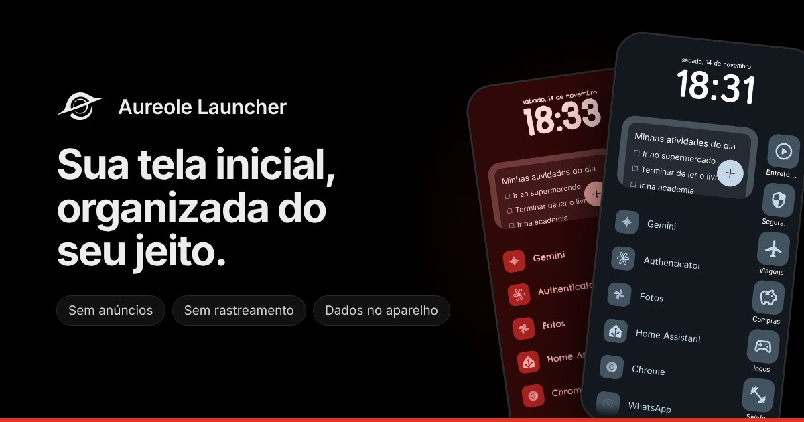
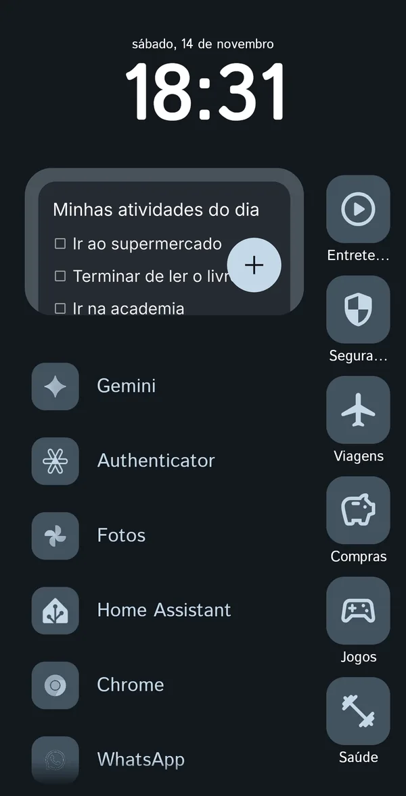
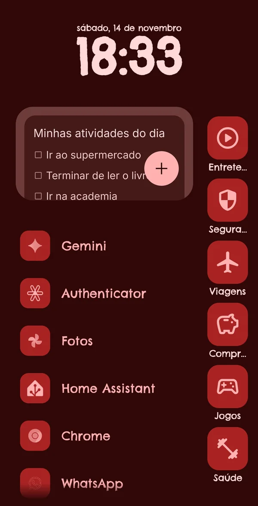
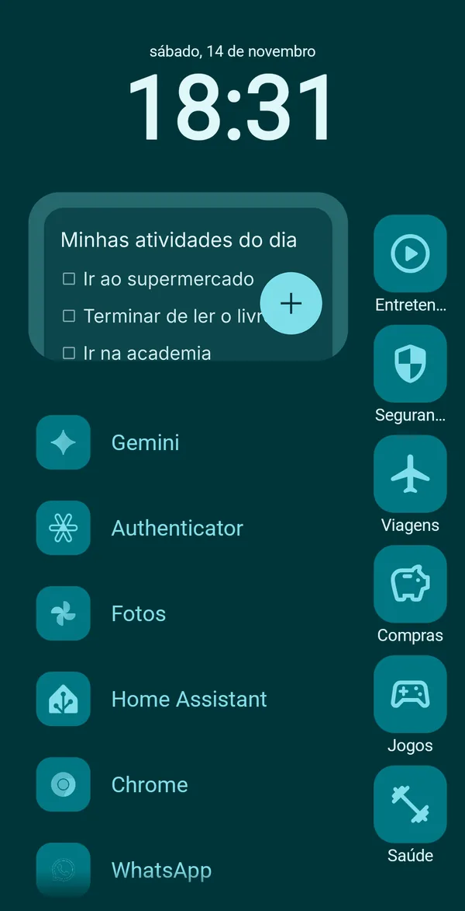
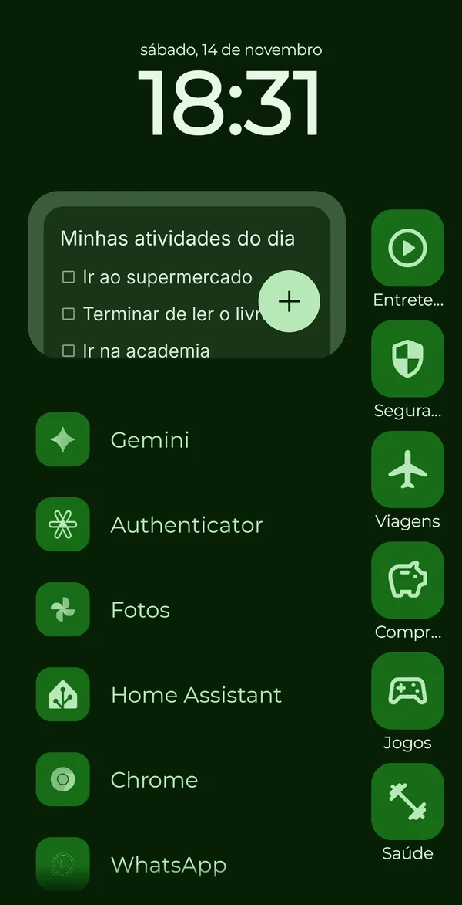
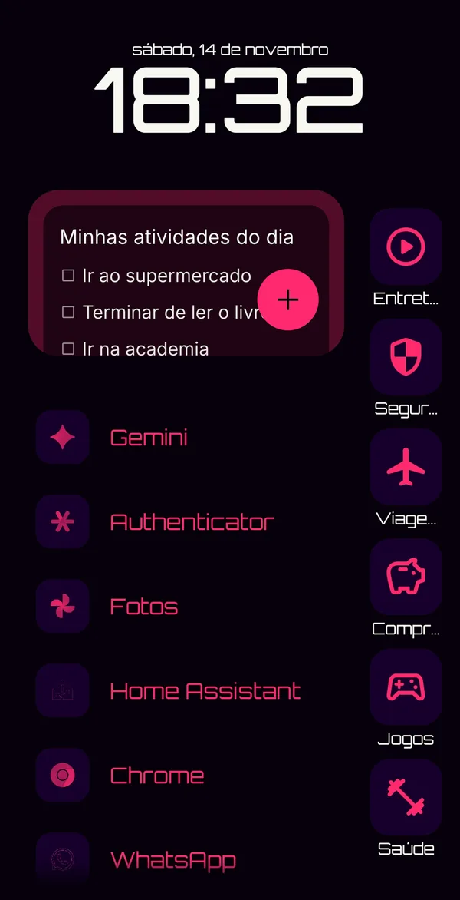

<p align="center">
  
</p>

<h1 align="center">Aureole Launcher</h1>

<p align="center">
  Um launcher Android leve, sem anúncios e sem rastreamento.<br>
  Relógios, favoritos, widgets e temas do seu jeito, com tudo guardado no seu aparelho.
</p>

<p align="center">
  <a href="https://play.google.com/store/apps/details?id=dev.mnascimentos.aureole"></a>
  <a href="https://aureolelauncher.app"></a>
  
  
  
  <a href="LICENSE"></a>
</p>

<p align="center">
  <a href="https://aureolelauncher.app">Site</a> ·
  <a href="https://play.google.com/store/apps/details?id=dev.mnascimentos.aureole">Google Play</a> ·
  <a href="https://aureolelauncher.app/privacy/pt-br/">Privacidade</a> ·
  <a href="https://aureolelauncher.app/terms/pt-br/">Termos de uso</a> ·
  <a href="https://thisaislan.github.io/ref/?alpf">Sugestões e bugs</a> ·
  <a href="#english">English</a>
</p>

<p align="center">
  
  
  
  
  
</p>

---

## Por que o Aureole

- **Pronto em menos de um minuto.** Uma apresentação guiada ensina os gestos e monta a tela. Sem conta e sem login.
- **Do seu jeito.** Dezenas de paletas, fontes, relógios e cartões com vidro, tudo com prévia na hora.
- **Privado de verdade.** Sem anúncios, sem analytics e sem servidor. Lista de apps, fotos e ajustes ficam no aparelho. A única coisa que sai são relatórios técnicos de falha (Firebase Crashlytics), sem nome, contatos, localização nem lista de apps.

## Destaques

| | |
| :--- | :--- |
| **Alfabeto na borda** | Deslize pelas letras e a gaveta pula direto para a escolhida, em destaque. |
| **Layout livre** | Arraste para mover e puxe a borda para redimensionar, com painéis laterais, em retrato ou paisagem. |
| **Widgets e pilhas** | Junte vários widgets no mesmo espaço e deslize entre eles. |
| **Relógios** | Só a hora, data em cima ou saudação do dia, com fonte, formato e cores à sua escolha. |
| **Paletas e fontes** | Dezenas de paletas com prévia ao tocar. Montserrat, Orbitron, Special Elite e mais. |
| **Cartões e vidro** | Cantos, desfoque e opacidade ajustáveis. |
| **Favoritos, pastas e contêineres** | Listas de favoritos no topo, pastas com nome e ícone, blocos na vertical ou na horizontal. |
| **Busca rápida** | Encontra apps e os widgets deles, com a barra perto do polegar. |
| **Botão rápido** | Abre um app ou atalho ao tocar, segurar ou deslizar. |
| **Feito para uma mão** | Menus perto do polegar, com modo canhoto. |
| **Ícones temáticos** | Os ícones acompanham as cores do tema. |
| **Desfazer e novidades** | Um toque desfaz a remoção. Cada atualização explica o que mudou, dentro do app. |

Veja tudo em movimento no [site](https://aureolelauncher.app).

## Privacidade e permissões

O Aureole não coleta dados pessoais. Detalhes na [política de privacidade](https://aureolelauncher.app/privacy/pt-br/).

| Permissão | Para quê |
| :--- | :--- |
| `BIND_APPWIDGET` | Hospedar widgets na tela inicial. |
| `SET_WALLPAPER` | Aplicar o papel de parede escolhido. |
| `REQUEST_DELETE_PACKAGES` | Desinstalar apps pelo menu do ícone. |

## Para quem desenvolve

### Stack

| Categoria | Tecnologia |
| :--- | :--- |
| Linguagem | Kotlin 2.4 (JVM 17) |
| UI | Jetpack Compose, Material 3 |
| Arquitetura | Clean Architecture, MVVM e UDF, package-by-feature |
| Dados | Room + KSP |
| Injeção de dependências | Koin 4 |
| Vidro e blur | [Haze](https://github.com/chrisbanes/haze) e Haze Materials |
| Imagens | Coil |
| Qualidade | Detekt, Android Lint, JaCoCo |
| Testes | JUnit 4, Robolectric, Compose UI Test, Compose Screenshot Testing |
| Play | In-App Updates, Firebase Crashlytics |

Min SDK 28 (Android 9), target SDK 37.

### Estrutura

```text
dev.mnascimentos.aureole/
├── AureoleApplication.kt     # Application e inicialização do Koin
├── MainActivity.kt           # Activity única
├── core/
│   ├── data/                 # Room, DAOs, repositórios e receivers
│   ├── designsystem/         # AureoleTheme, tokens e componentes Aureole*
│   └── lifecycle/            # Observers de ciclo de vida (widgets, in-app update)
├── di/                       # Módulos Koin
└── feature/
    ├── home/                 # Tela inicial: gaveta, relógios, contêineres, widgets, grade
    └── settings/             # Configurações
```

### Convenções

As regras completas estão em [`ARCHITECTURE.md`](ARCHITECTURE.md) e em [`agents/`](agents/index.md). As principais:

- Parâmetros e modelos de UI ficam em `model/`, nunca dentro do arquivo da tela.
- Componentes públicos do design system levam o prefixo `Aureole` e usam tokens (`AureoleDS.colors`, `AureoleDS.dimens`), sem valores soltos de `dp` e `sp`.
- Estado e ações chegam à árvore por `LocalHomeUiState` e `LocalHomeActions`, sem cascata de callbacks.
- Textos sempre em `strings.xml` (inglês e `pt-rBR`), sem texto fixo no código.
- Todo componente visual tem `@AureolePreview`.

### Comandos

```bash
./gradlew :app:assembleDebug                 # APK de debug
./gradlew :app:assembleRelease               # release com R8
./gradlew detekt                             # análise estática
./gradlew :app:lintDebug                     # Android Lint
./gradlew :app:testDebugUnitTest             # testes unitários
./gradlew :app:validateDebugScreenshotTest   # valida screenshots
./gradlew :app:updateDebugScreenshotTest     # atualiza as referências
./gradlew :app:jacocoTestReport              # cobertura (app/build/reports/jacoco/)
```

Pré-requisitos: Android Studio recente e JDK 17.

### Site

O site do projeto fica em [`docs/`](docs) (HTML e CSS estáticos, em português e inglês) e é publicado no GitHub Pages por [`pages.yml`](.github/workflows/pages.yml) a cada push no `main`, em [aureolelauncher.app](https://aureolelauncher.app).

## Equipe

| | |
| :--- | :--- |
| [**Mateus Nascimento**](https://github.com/MNascimentoS) | O Criador |
| [**Aislan Tavares**](https://github.com/thisaislan) | O Sonhador |

## Licença

[PolyForm Noncommercial License 1.0.0](LICENSE) (source-available). Uso pessoal e modificações não comerciais são permitidos. Comercialização, distribuição com fins lucrativos e forks para monetização não são.

---

<a id="english"></a>

## English

**Aureole Launcher** is a lightweight Android home screen with no ads and no tracking. Set up clocks, favorites, folders, widget stacks and themes your way, and everything you configure stays on your device. No account, no login.

- Alphabet on the edge, free layout, widget stacks and clocks
- Dozens of palettes and fonts, with glass cards you can tune
- Built for one hand, with a left-handed mode
- Only technical crash reports leave the device (Firebase Crashlytics)

[Google Play](https://play.google.com/store/apps/details?id=dev.mnascimentos.aureole) · [Website](https://aureolelauncher.app/en/) · [Privacy](https://aureolelauncher.app/privacy/en/) · [Terms](https://aureolelauncher.app/terms/en/) · [Suggestions and bugs](https://thisaislan.github.io/ref/?alef)

The developer sections above (stack, structure, conventions and Gradle commands) apply as they are.
