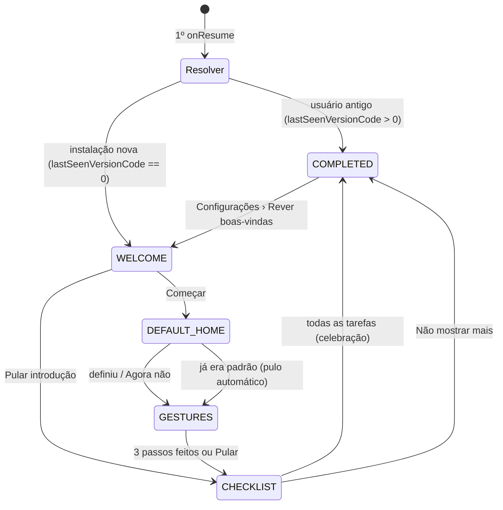

# Primeira Órbita: experiência de primeiro uso (FUE)

| | |
|---|---|
| **Status** | Proposta, aguardando aprovação |
| **Base de código analisada** | `release/0.8.30` (`63c5e7b`), idêntica à cópia local |
| **Protótipo navegável** | Artifact "Aureole Primeira Órbita" (arquivo também em [`prototype.html`](prototype.html)) |
| **Storyboard** | [`storyboard.png`](storyboard.png) |
| **Plano de implementação** | [`IMPLEMENTATION_PLAN.md`](IMPLEMENTATION_PLAN.md) |
| **Steerings respeitadas** | `AGENTS.md`, `agents/*.md`, `ARCHITECTURE.md`, `.github/copilot-instructions.md` (guardrails) |

---

## 1. Problema

Quem instala o Aureole hoje cai numa home sem nenhuma orientação. Lendo o código, encontrei estes pontos de abandono:

| # | O que acontece hoje | Onde | Impacto |
|---|---|---|---|
| P1 | O Aureole **não vira a tela inicial padrão** após instalar. O usuário aperta Início e volta ao launcher antigo. | `MainActivity` (só é aberto pelo ícone) | Principal motivo de "abri e não entendi nada". |
| P2 | Na primeira abertura, o **"Novidades da versão" abre sozinho**, mostrando mudanças de versões que a pessoa nunca usou. | `checkReleaseNotes()`: `lastSeenVersionCode` começa em `0`, sempre menor que o `versionCode` | A primeira coisa vista é irrelevante. |
| P3 | O **diálogo de atualização** pode competir com tudo isso no primeiro `onResume`. | `UpdateLifecycleObserver` → `checkAppUpdate()` | Ruído no primeiro contato. |
| P4 | **Gestos invisíveis**: deslizar para cima (gaveta), para baixo (notificações), borda direita (alfabeto curvo), tocar e segurar (Personalizar), botão Início alterna a gaveta (`homeButtonOpensAllApps = true`). | `homeDragGestures`, `DynamicGridContainer` | Os recursos que diferenciam o app não são descobertos. |
| P5 | O **container padrão está vazio** (só um "+") e a lista mostra "TODOS OS APPS" sem favoritos. | `GridDefaults`, `FavoritesList` | A home parece inacabada. |
| P6 | A primeira sincronização mostra um **spinner** (`isLoading`). | `HomeScreenBody` | Primeiro frame sem personalidade. |

## 2. Objetivos e princípios

**Objetivo:** em menos de 1 minuto, a pessoa (a) tem o Aureole como tela inicial, (b) sabe abrir os apps e personalizar a tela, (c) tem um caminho claro para deixar a home com a cara dela.

Princípios que guiam cada decisão:

1. **Aprender fazendo.** Nada de carrossel de slides. Os gestos são ensinados na home real e cada passo conclui quando o gesto de verdade acontece.
2. **Nunca prender.** Tudo é pulável. Pular nunca perde o essencial: o que ficou para trás vira item na lista de primeiros passos.
3. **Progresso comprovado pelo estado real.** Um item só se marca quando o `MainUiState` prova que a tarefa foi feita (favoritos existem, container tem itens, etc.).
4. **Recompensa visual imediata.** Paleta e fonte abrem na própria home e a tela muda ao vivo atrás do sheet.
5. **Respeita o que já existe.** Usa `AureoleDS` (cores, raio configurável, fonte escolhida), modo canhoto, blur (Haze) quando suportado, animações do sistema e TalkBack.
6. **Silêncio depois.** Concluído, nunca mais aparece sozinho; dá para rever em Configurações.

**Fora de escopo:** analytics (o projeto removeu Firebase Analytics por privacidade), tours de novidades para usuários antigos, papel de parede como tarefa (fica para uma próxima iteração).

## 3. Visão geral do fluxo



| Estágio | Bloqueia a home? | Persiste? | Onde aparece |
|---|---|---|---|
| `WELCOME` | Sim (entra em `isOverlayActive`) | Sim | Camada em tela cheia no `MainScaffold` |
| `DEFAULT_HOME` | Sim | Sim | Cartão inferior + diálogo do sistema |
| `GESTURES` | **Não**: os toques chegam na home | Sim (passos feitos) | Cartão no topo + dedo animado |
| `CHECKLIST` | Só quando expandida (scrim) | Sim (tarefas, recolhida) | Lista central ou pílula inferior |
| `COMPLETED` | Não | Sim | Celebração de 2,6 s, depois nada |

## 4. Etapas em detalhe

### 4.1 WELCOME: "Ignição do halo"

- Cobre a primeira sincronização de apps no lugar do spinner (P6).
- Coreografia: anel desenha 360°, brilho radial expande e pulsa, logo sobe com leve overshoot, título, subtítulo e botões entram em cascata. Ao sair, o halo expande ×7 e "abre" a próxima etapa.
- **Começar** → `DEFAULT_HOME`. **Pular introdução** → `CHECKLIST` (nada essencial se perde: "Definir como tela inicial" é o 1º item da lista).
- Voltar: sem efeito (é a raiz do launcher).

### 4.2 DEFAULT_HOME: "Faça do Aureole sua casa" (resolve P1)

- API 29+: `RoleManager.createRequestRoleIntent(ROLE_HOME)` via `rememberLauncherForActivityResult`.
- API 28 (minSdk) ou papel indisponível: `SettingsIntentUtils.openDefaultLauncherSettings()` (já existe).
- O resultado **não confia no `resultCode`**: no retorno, chama `settingsRepository.checkDefaultLauncher()`. Alguns fabricantes devolvem `RESULT_CANCELED` mesmo após aceitar.
- Se ainda não for padrão após uma tentativa, aparece o link "Abrir configurações do sistema".
- **Agora não** → segue para `GESTURES`; o item fica pendente na lista.
- Se o Aureole **já é** o padrão ao entrar na etapa, ela é pulada sem ser exibida.
- Voltar → `WELCOME`.

### 4.3 GESTURES: coach interativo (resolve P4)

Cartão no topo com indicador de 3 passos e um "dedo fantasma" animado. A camada **não tem `pointerInput`** (só os botões do cartão são clicáveis), então o gesto real chega no `homeDragGestures` da home.

| Passo | Ensina | Concluído quando | Avança quando |
|---|---|---|---|
| `OPEN_APPS` | Deslizar para cima (e: o botão Início também abre a lista) | `isAllAppsDrawerOpen` passa de `false` para `true` | gaveta fecha |
| `ALPHABET_SCRUB` | Deslizar na borda direita (esquerda no modo canhoto) e descer | sinal `ALPHABET_SCRUBBED` vindo de `ScrubberOverlay.onLetterSelected` | gaveta fecha |
| `CUSTOMIZE` | Tocar e segurar num espaço vazio | `showCustomizeBottomSheet` passa de `false` para `true` | sheet fecha |

- Passos podem ser concluídos fora de ordem; o passo atual é sempre o primeiro pendente.
- `ALPHABET_SCRUB` é omitido se `isAlphabetScrubberDisabled`.
- **Mostrar para mim** aparece após 8 s sem progresso, ou imediatamente com TalkBack ligado; executa a ação e conclui o passo: abre a gaveta (passos 1 e 2, com o alfabeto visível) ou abre Personalizar (passo 3).
- Sucesso: título vira "Isso aí!", check verde no indicador, `HapticFeedbackType.Confirm`.
- **Pular** conclui todos os passos e vai para `CHECKLIST`.

### 4.4 CHECKLIST: "Primeiros passos" (referência do Figma)

Animação de entrada fiel ao frame "Animation": a lista nasce abaixo da tela, sobe com overshoot e assenta no terço superior. Cabeçalho com o **halo de progresso** (o anel do logo é a barra de progresso).

Numa instalação nova a home começa **vazia** (`[]` gravado em retrato e paisagem); cada passo de grid coloca o seu item na posição do layout padrão v3 (ver [`CHANGES_2026-10-28.md`](CHANGES_2026-10-28.md)).

| Ordem | Tarefa (`OnboardingTask`) | Ação ao tocar | Concluída quando |
|---|---|---|---|
| 1 | `SET_DEFAULT_HOME` | mesmo fluxo da 4.2 | `onboarding.isDefaultLauncher == true` (checado em todo `onResume`) |
| 2 | `CHOOSE_PALETTE` | abre `PickPaletteBottomSheet` **na home**, com preview ao vivo | usuário tocou em uma paleta e em **Ficou bom** |
| 3 | `CHOOSE_FONT` | abre `PickFontBottomSheet` **na home**, com preview ao vivo | usuário tocou em uma fonte e em **Ficou bom** |
| 4 | `ADD_CLOCK` | `startGridTask` coloca o `CLOCK` → `onOpenEditClockBottomSheet()` | layout salvo com um `CLOCK` |
| 5 | `ADD_FAVORITE_APPS` | `startGridTask` coloca o `APPS_LIST` → `onOpenFavoritePicker(id)` | layout salvo com ≥ 1 favorito no `APPS_LIST` |
| 6 | `FILL_CONTAINER` | `startGridTask` coloca o `SHORTCUTS_CONTAINER` → `onOpenEditContainerDialog(id)` | **Salvar** no editor do container, mesmo vazio |
| 7 | `ADD_WIDGET` | `startGridTask` coloca o `WIDGET_LIST` → `onAddWidgetClick(id)` | layout salvo com ≥ 1 widget na pilha do item |
| 8 | `EXPLORE_SETTINGS` | `onSettingsClick()` (só marca a pendência) | volta do Settings para a home (`onReturnedToHome`) |

Regras:
- Paleta e fonte vêm logo depois da tela inicial de propósito: são vitórias rápidas com recompensa visual imediata, o que dá impulso para o resto.
- Enquanto um picker de aparência está aberto, a lista some e o scrim sai, para a pessoa ver a home inteira re-tematizar atrás do sheet. Ao tocar **Ficou bom**, a lista volta com o item marcado.
- Ao tocar numa tarefa que abre um editor existente (relógio, favoritos, container, widget, Settings), a lista **recolhe para a pílula** antes de abrir o editor, porque o host do onboarding é a última camada do `MainScaffold` e não pode cobrir o editor. A pílula some enquanto qualquer outra sobreposição da home estiver ativa.
- **Concluir só ao salvar.** Os passos de grid deixam o item em modo de edição e guardam a tarefa em `pendingTask`. Ela é avaliada uma única vez, quando o editor e o modo de edição fecham. Concluiu: marca, reabre a lista e dispara o haptic. Falhou: o item criado sai da home, a pendência é limpa e a lista reabre sem marcar. Cancelar o modo de edição também falha. Favoritos é exceção: sem favoritos, o `APPS_LIST` criado vira um `ALL_APPS_LIST` na mesma posição.
- Enquanto uma tarefa de grid espera em modo de edição, sem editor por cima, um chip no topo diz "Arraste para mover, puxe a borda para redimensionar." e tem o botão **Salvar**.
- Itens concluídos são **persistidos e não desmarcam** (apagar um favorito depois não "desfaz" o passo).
- Se já era a tela inicial padrão, o item 1 já aparece marcado (progresso inicial "1 de 8").
- O próximo item pendente tem um contorno "respirando".
- **Minimizar** → pílula inferior com halo + "3/8 primeiros passos"; tocar reabre. Voltar com a lista aberta também minimiza.
- **Não mostrar mais** → `COMPLETED` + Toast "Você pode rever em Configurações › Avançado". Se a home estiver vazia (por orientação), aplica o layout padrão v3.
- Lista expandida bloqueia a home (scrim); tocar no scrim minimiza.

### 4.5 COMPLETED: celebração

Ao concluir a última tarefa: a lista desce, o halo fecha o círculo, ≤ 40 partículas saem do centro e o texto "Tudo pronto" aparece. Some sozinho em 2,6 s e **não bloqueia** toques. O estágio é persistido como `COMPLETED` no momento em que a última tarefa conclui, então a celebração não se repete após morte de processo.

A celebração só toca com a home em primeiro plano. No caso normal, "Explore mais ajustes" é o último item e ela aparece na volta do Settings. Se a última tarefa concluir com a home escondida (diálogo do sistema, outro app), `isCelebrationPending` guarda a celebração para o próximo `onResume`.

### 4.6 Rever boas-vindas

Configurações › Avançado › **Rever boas-vindas** reinicia o estado (`WELCOME`, passos e tarefas limpos) e fecha o Settings (`shouldFinishActivity`). No próximo `onResume` da home o fluxo começa. Paleta, fonte e layout atuais **não** são alterados.

## 5. Copy (EN padrão + PT-BR)

Convenção: `<feature>_<component>_<description>` → prefixo `home_onboarding_`. Trechos em negrito usam `<b>` escapado no XML (`&lt;b&gt;`, como na tabela) e `AnnotatedString.fromHtml(stringResource(...))` (Compose 1.7+, coberto pelo BOM `2026.09.00`).

| Chave | EN (`values/`) | PT-BR (`values-pt-rBR/`) |
|---|---|---|
| `home_onboarding_welcome_title` | Welcome to Aureole | Bem-vindo ao Aureole |
| `home_onboarding_welcome_subtitle` | A light, beautiful home screen, made your way. Getting started takes less than a minute. | Uma tela inicial leve, bonita e do seu jeito. Leva menos de um minuto para começar. |
| `home_onboarding_welcome_start` | Let\'s begin | Começar |
| `home_onboarding_welcome_skip` | Skip intro | Pular introdução |
| `home_onboarding_default_title` | Make Aureole your home | Faça do Aureole sua casa |
| `home_onboarding_default_body` | So the Home button opens Aureole, pick it as your home app. You can switch back anytime. | Para o botão Início abrir o Aureole, escolha-o como app de tela inicial. Você pode trocar quando quiser. |
| `home_onboarding_default_confirm` | Set as home app | Definir como tela inicial |
| `home_onboarding_default_later` | Not now | Agora não |
| `home_onboarding_default_open_settings` | Open system settings | Abrir configurações do sistema |
| `home_onboarding_default_success` | Done! Aureole is now your home screen. | Pronto! O Aureole agora é sua tela inicial. |
| `home_onboarding_coach_skip` | Skip | Pular |
| `home_onboarding_coach_show_me` | Show me | Mostrar para mim |
| `home_onboarding_coach_success` | Nice! | Isso aí! |
| `home_onboarding_coach_apps_title` | Swipe up | Deslize para cima |
| `home_onboarding_coach_apps_body` | to see all your apps. The Home button also opens and closes the list. | para ver todos os seus apps. O botão Início também abre e fecha a lista. |
| `home_onboarding_coach_apps_done` | Your apps live here. Tap outside to close. | Seus apps estão aqui. Toque fora para fechar. |
| `home_onboarding_coach_scrub_title_right` | Swipe along the right edge | Deslize na borda direita |
| `home_onboarding_coach_scrub_title_left` | Swipe along the left edge | Deslize na borda esquerda |
| `home_onboarding_coach_scrub_body` | and slide down to jump straight to a letter. | e desça o dedo para pular direto para uma letra. |
| `home_onboarding_coach_scrub_done` | Quick, right? Let go to close. | Rápido, né? Solte para fechar. |
| `home_onboarding_coach_customize_title` | Touch and hold | Toque e segure |
| `home_onboarding_coach_customize_body` | an empty spot on the screen to customize what shows up there. | em um espaço vazio da tela para personalizar o que aparece nela. |
| `home_onboarding_coach_customize_done` | This is where you build your screen. | É aqui que você monta sua tela. |
| `home_onboarding_checklist_title` | First steps | Primeiros passos |
| `home_onboarding_checklist_progress` | %1$d of %2$d done | %1$d de %2$d concluídos |
| `home_onboarding_checklist_pill` | %1$d/%2$d first steps | %1$d/%2$d primeiros passos |
| `home_onboarding_checklist_minimize` | Minimize | Minimizar |
| `home_onboarding_checklist_dismiss` | Don\'t show again | Não mostrar mais |
| `home_onboarding_checklist_dismissed` | You can replay it in Settings › Advanced. | Você pode rever em Configurações › Avançado. |
| `home_onboarding_task_default_home` | Set as &lt;b&gt;home app&lt;/b&gt; | Definir como &lt;b&gt;tela inicial&lt;/b&gt; |
| `home_onboarding_task_palette` | Pick a &lt;b&gt;color palette&lt;/b&gt; | Escolha uma &lt;b&gt;paleta de cores&lt;/b&gt; |
| `home_onboarding_task_font` | Pick a &lt;b&gt;font&lt;/b&gt; | Escolha uma &lt;b&gt;fonte&lt;/b&gt; |
| `home_onboarding_task_apps` | Add some &lt;b&gt;apps&lt;/b&gt; | Escolha seus &lt;b&gt;apps&lt;/b&gt; |
| `home_onboarding_task_container` | Fill the &lt;b&gt;container&lt;/b&gt; | Preencha o &lt;b&gt;container&lt;/b&gt; |
| `home_onboarding_task_widget` | Add some &lt;b&gt;widgets&lt;/b&gt; | Adicione &lt;b&gt;widgets&lt;/b&gt; |
| `home_onboarding_task_settings` | Check more &lt;b&gt;settings&lt;/b&gt; | Explore mais &lt;b&gt;ajustes&lt;/b&gt; |
| `home_onboarding_picker_hint` | Tap to see your screen change right away. | Toque para ver sua tela mudar na hora. |
| `home_onboarding_picker_done` | Looks good | Ficou bom |
| `home_onboarding_done_title` | All set | Tudo pronto |
| `home_onboarding_done_subtitle` | Your Aureole is shining. Enjoy! | Seu Aureole está brilhando. Bom proveito! |
| `home_onboarding_task_done_a11y` | %1$s, done | %1$s, concluído |
| `home_onboarding_task_pending_a11y` | %1$s, not done yet | %1$s, pendente |
| `settings_advanced_replay_onboarding` | Replay welcome tour | Rever boas-vindas |

Títulos dos pickers reutilizam as strings que eles já têm.

## 6. Motion

Todas as constantes de animação ficam em `model/OnboardingMotionSpec.kt` (valores `dp` hardcoded são permitidos para animações, offsets e restrições de layout pela steering de Design System; **nunca** usar tokens de layout para física ou blur).

| Momento | Spec |
|---|---|
| Anel do halo | `Animatable(0f→360f)`, `tween(1000, delay 200, FastOutSlowInEasing)` |
| Logo | alpha 0→1 + scale 0.85→1, `spring(dampingRatio = 0.6f, stiffness = Spring.StiffnessMediumLow)`, delay 500 |
| Textos e botões | fade + translateY 18dp→0, `tween(500)`, delays 900 / 1050 / 1250 |
| Brilho | escala 0.6→1 e depois pulso infinito 1→1.12 (3,2 s) |
| Saída do welcome | halo scale 1→7 + alpha→0, `tween(550, FastOutLinearInEasing)` |
| Cartões (default, coach) | slide de fora da tela, `spring(dampingRatio = 0.8f, stiffness = 300f)` |
| Dedo: deslizar para cima | loop 1,8 s: aparece 150 ms, sobe ~30% da altura (FastOutSlowIn), some, pausa |
| Dedo: borda | loop 1,9 s: entra pela borda, puxa 30dp para dentro, desce ~20% |
| Dedo: tocar e segurar | loop 1,8 s: anel de pressão preenche 0→1 em 600 ms |
| Lista: entrada (Figma) | `translationY` da base até o destino com `spring(dampingRatio = 0.65f, stiffness = 180f)` (overshoot visível); itens com stagger de 60 ms (alpha + 16dp) |
| Item concluído | ícone → check com `Crossfade`, halo avança com spring, `HapticFeedbackType.Confirm` |
| Próximo item | contorno "respirando", `infiniteRepeatable(tween(2200))` |
| Lista ↔ pílula | `AnimatedContent` + `SizeTransform`, spring 0.8 |
| Celebração | halo fecha em 700 ms; ≤ 40 partículas num único `Canvas`, desenhadas na fase de draw |

**Movimento reduzido:** se `ValueAnimator.areAnimatorsEnabled()` for falso, nada de loops nem partículas; transições viram troca direta. As animações Compose já respeitam a escala do sistema; os loops de `Canvas` com `withFrameNanos` precisam desse check explícito.

**Previews e screenshot tests:** com `LocalInspectionMode.current == true`, os componentes renderizam o estado final assentado (mesmo padrão do `SettingsBottomSheet`).

## 7. Visual

- Cores só de `AureoleDS.colors`. Fundo do welcome: gradientes radiais com `surfaceVariant`, `outline` e `onSurfaceLow` com alpha, sem hex.
- Superfícies de vidro: `hazeEffect` com `HazeTint(surfaceVariant.copy(alpha = hazeOpacity))` quando `isHazeEnabled`; senão, `surface` com alpha (mesmo padrão do `AddWidgetButton`).
- Raio: `AureoleDS.dimens.radiusLarge`, que já reflete o raio escolhido pelo usuário.
- Tipografia: `displaySmall` (título do welcome), `titleLarge`, `bodyLarge`, `smallText`, sempre via `AureoleText`.
- Ícones existentes: `Logo`, `Home`, `ColorFill` (paleta), `Text` (fonte), `Edit` (apps), `VerticalContainer`, `MultipleView` (widgets), `Settings`, `RoundCheck`, `Press`.
- Check concluído usa `colors.badgeContainer` / `badgeText` (cor semântica que já existe).
- Largura máxima da lista: 420dp (restrição de layout, constante privada) para landscape e tablets.

## 8. Acessibilidade

- Alvos de toque ≥ `AureoleDS.dimens.minTouchTarget` (48dp).
- Cartão do coach com `liveRegion = LiveRegionMode.Polite`; título do passo anunciado ao trocar.
- Itens da lista com `Role.Button` e `contentDescription` com estado (`home_onboarding_task_done_a11y` / `_pending_a11y`).
- TalkBack ligado (`AccessibilityManager.isTouchExplorationEnabled`) → "Mostrar para mim" visível desde o início.
- Fonte em 200%: lista rolável, pílula com `maxLines = 1` e reticências.
- Contraste: texto `onSurfaceHigh`/`onSurfaceMedium` sobre `surface`, como no resto do app.

## 9. Casos de borda

| Caso | Comportamento |
|---|---|
| Usuário antigo atualiza para a versão com FUE | `lastSeenVersionCode > 0` → `COMPLETED`. Release notes funcionam como hoje e anunciam "Rever boas-vindas". |
| Instalação nova | Release notes **nunca** abrem quando `lastSeenVersionCode == 0`; o valor é gravado em silêncio (resolve P2). |
| Atualização disponível durante `WELCOME`/`DEFAULT_HOME` | `checkAppUpdate()` retorna cedo; o diálogo aparece num próximo `onResume` (resolve P3). |
| Botão Início durante estágio bloqueante | `onNewIntent` ignora a alternância da gaveta. |
| Aureole virou padrão pelas configurações do sistema, fora do fluxo | `onResume` revalida `checkDefaultLauncher()`; item marca sozinho e `DEFAULT_HOME` é pulado. |
| Processo morto no meio | Estágio, passos e tarefas persistidos; retoma no mesmo estágio (welcome reanima do início). |
| Rotação / landscape | Estado no ViewModel; layouts com largura máxima; lista rolável. |
| Modo canhoto | Dedo e texto do passo de borda espelhados; gaveta já respeita o modo. |
| Barra alfabética desativada | Passo `ALPHABET_SCRUB` omitido; indicador mostra 2 passos. |
| Sem suporte a Haze (API < 31 ou low-RAM) | Superfícies sólidas com alpha. |
| Animações do sistema desligadas | Ver seção 6. |
| Reset de fábrica | Limpa `aureole_settings_prefs` → `lastSeenVersionCode = 0` → FUE roda de novo, como num aparelho novo. |
| Backup/restauração | `aureole_settings_prefs` já é excluído do backup; um aparelho restaurado começa com a home padrão e com o FUE. |
| `apps_list_item` ou `container_item` removidos antes de tocar na tarefa | Usa o 1º item do tipo no grid; sem nenhum, cria (container) ou usa favoritos globais (apps). |
| Widget: usuário cancela a configuração | Fluxo existente apaga o `pendingWidgetId`; tarefa continua pendente. |
| Tarefa concluída antes de a lista aparecer | Aparece já marcada, sem animação de conclusão. |

## 10. Arquitetura

### 10.1 Onde mora

Overlay da home, não uma Activity separada, seguindo o precedente de `overlays/`, `quickbutton/` e `widgets/`:

```text
feature/home/components/onboarding/
├── OnboardingHostComponent.kt         # roteia por estágio (AnimatedContent)
├── WelcomeScreen.kt
├── WelcomeHaloComponent.kt            # anel + brilho + estrelas (Canvas)
├── DefaultHomeStepComponent.kt
├── GestureCoachComponent.kt
├── GestureCoachHandComponent.kt       # dedo/trilha/anel de pressão
├── OnboardingChecklistComponent.kt
├── OnboardingChecklistItemComponent.kt
├── OnboardingChecklistPillComponent.kt
├── OnboardingAppearancePickerComponent.kt  # hospeda os pickers de paleta/fonte na home
├── OnboardingCelebrationComponent.kt
├── extensions/
│   ├── HomeViewModelOnboardingExt.kt  # sync, avançar, pular, voltar, sinais, replay
│   └── OnboardingReducer.kt           # funções puras: MainUiState → MainUiState
└── model/
    ├── OnboardingUiState.kt           # OnboardingUiState, AppearancePicker, derivadas e mappers
    ├── OnboardingActions.kt
    └── OnboardingMotionSpec.kt

core/data/model/OnboardingProgress.kt                # enums de estágio/passo/tarefa + OnboardingProgress (core não importa feature)
core/data/repository/OnboardingPreferences.kt        # persistência (composta no SettingsRepository)
core/designsystem/components/AureoleHaloProgress.kt  # anel de progresso com logo (KDoc obrigatório)
core/designsystem/palette/ThemeSeedColor.kt          # seed color da paleta, compartilhado pelos 2 ViewModels
composable/sheets/PickPaletteBottomSheet.kt          # movido de feature/settings (agora usado por 2 telas)
composable/sheets/PickFontBottomSheet.kt             # idem
util/DefaultHomeRoleUtils.kt                         # intent do RoleManager
```

Todos os arquivos `*Screen.kt` / `*Component.kt` contêm **apenas** `@Composable`. Modelos ficam em `model/`.

### 10.2 Modelos

Os enums e o `OnboardingProgress` (o que é persistido) ficam em `core/data/model/OnboardingProgress.kt`, para a camada `core` não depender de `feature/`. O estado de UI fica na feature:

```kotlin
enum class OnboardingStage { WELCOME, DEFAULT_HOME, GESTURES, CHECKLIST, COMPLETED }
enum class GestureCoachStep { OPEN_APPS, ALPHABET_SCRUB, CUSTOMIZE }
enum class OnboardingTask {
    SET_DEFAULT_HOME, CHOOSE_PALETTE, CHOOSE_FONT, ADD_CLOCK,
    ADD_FAVORITE_APPS, FILL_CONTAINER, ADD_WIDGET, EXPLORE_SETTINGS
}
enum class AppearancePicker { PALETTE, FONT }

data class OnboardingUiState(
    val stage: OnboardingStage = OnboardingStage.COMPLETED, // padrão neutro: testes e previews atuais não mudam
    val completedSteps: Set<GestureCoachStep> = emptySet(),
    val succeededStep: GestureCoachStep? = null,             // feedback "Isso aí!" até a superfície fechar
    val completedTasks: Set<OnboardingTask> = emptySet(),
    val isDefaultLauncher: Boolean = false,
    val defaultHomeAttempted: Boolean = false,
    val isChecklistExpanded: Boolean = true,
    val activePicker: AppearancePicker? = null,
    val isCelebrating: Boolean = false,
    // Transientes, nunca persistidos:
    val pendingTask: OnboardingTask? = null,       // tarefa esperando o salvar (ou a volta do Settings)
    val createdItemId: String? = null,             // item que a tarefa colocou; sai da home se ela falhar
    val isHomeInForeground: Boolean = true,
    val isCelebrationPending: Boolean = false,     // tudo concluído com a home escondida
)

val OnboardingUiState.isBlocking: Boolean
    get() = stage == OnboardingStage.WELCOME || stage == OnboardingStage.DEFAULT_HOME
val OnboardingUiState.blocksHome: Boolean
    get() = isBlocking || activePicker != null ||
        (stage == OnboardingStage.CHECKLIST && isChecklistExpanded)
```

`MainUiState` ganha **um** campo: `val onboarding: OnboardingUiState = OnboardingUiState()`. `HomeScreenActions` ganha **um** campo: `val onboarding: OnboardingActions = OnboardingActions()`. Os dois têm padrão, então `createDefaultHomeScreenActions()` e os 23 testes que constroem `HomeRepositories`/`MainUiState` continuam compilando sem mudança.

### 10.3 Persistência (ADR-2)

`OnboardingPreferences` é uma classe própria (testável isolada) **composta dentro do `SettingsRepository`** e gravando no mesmo arquivo `aureole_settings_prefs`, com chaves `onboarding_*`:

| Chave | Tipo | Observação |
|---|---|---|
| `onboarding_stage` | String? | `null` = ainda não resolvido. Valor inválido → `COMPLETED` (nunca prender o usuário). |
| `onboarding_completed_steps` | String (CSV de enum) | nomes desconhecidos são ignorados |
| `onboarding_completed_tasks` | String (CSV de enum) | idem |
| `onboarding_checklist_collapsed` | Boolean | |

API: `settingsRepository.onboarding.read(): OnboardingProgress?` (`null` = nunca resolvido), `write(progress)` e `restart()`. O precedente é o `lastSeenVersionCode`, que já mora no `SettingsRepository`.

### 10.4 Lógica central (funções puras)

O ponto único de mutação do Home já existe: `HomeViewModel.updateUiState()`. A detecção de progresso entra lá como uma função pura:

```kotlin
internal fun updateUiState(transform: (MainUiState) -> MainUiState) {
    val before = _uiState.value.onboarding
    _uiState.update { current -> OnboardingReducer.reduce(previous = current, next = transform(current)) }
    val after = _uiState.value.onboarding
    if (after != before) persistOnboarding(after)   // fora do lambda: update{} pode reexecutar
}
```

`OnboardingReducer.reduce` retorna `next` intacto quando `stage` é `COMPLETED`, `WELCOME` ou `DEFAULT_HOME` (custo zero no uso normal). Em `GESTURES`, compara `previous` × `next` para detectar gaveta e Personalizar abrindo e fechando. Em `CHECKLIST`, só a tela inicial é derivada do estado (`isDefaultLauncher`); as tarefas de grid concluem no ponto de confirmação (`confirmPendingTask`, chamado ao fim de `updateUiState`), e o container no **Salvar** do editor (`confirmContainerTaskOnSave`). Com todas concluídas, vai para `COMPLETED` com `isCelebrating = isHomeInForeground`.

Sinais que não estão no estado (`ALPHABET_SCRUBBED`, picker escolhido, settings aberto, resultado do papel de tela inicial) entram por funções explícitas em `HomeViewModelOnboardingExt.kt`.

### 10.5 Pontos de integração

| Arquivo | Mudança | Linhas hoje → depois (estimado) |
|---|---|---|
| `core/lifecycle/MainLifecycleObserver.kt` | `viewModel.syncOnboarding()` **antes** de `checkReleaseNotes` (a extensão consulta `settingsRepository.checkDefaultLauncher()`) | 58 → 61 |
| `feature/home/components/overlays/extensions/HomeViewModelReleaseNotesExt.kt` | não mostrar se `lastSeen == 0` ou onboarding ≠ `COMPLETED`; continua gravando `lastSeenVersionCode` | 24 → 28 |
| `feature/home/extensions/MainActivityUpdateExt.kt` | `return` cedo se `onboarding.isBlocking` | 45 → 46 |
| `feature/home/extensions/MainActivityNavExt.kt` | voltar: onboarding primeiro (estágio anterior / minimizar / fechar picker) | 64 → 72 |
| `feature/home/model/MainUiState.kt` | campo `onboarding` + `blocksHome` em `isOverlayActive` | 190 → 194 |
| `feature/home/model/HomeScreenActions.kt` | campo `onboarding` | 114 → 116 |
| `feature/home/HomeViewModel.kt` | `updateUiState` com reducer | 143 → 150 |
| `feature/home/MainScaffold.kt` | `OnboardingOverlay(...)` como última camada | 160 → 175 |
| `feature/home/MainRoute.kt` | launcher do papel de tela inicial | 149 → 175 |
| `feature/home/components/overlays/HomeOverlays.kt` | sinal `ALPHABET_SCRUBBED` em `onLetterSelected` | 319 → 321 |
| `MainActivity.kt` | `onNewIntent` ignora alternância durante estágio bloqueante | 162 → 164 |
| `HomeActionsFactory.kt` | delega para `OnboardingActionsFactory` (novo arquivo) | 264 → 266 |
| `core/data/repository/SettingsRepository.kt` | `val onboarding = OnboardingPreferences { prefs }` | 373 → 376 |
| `feature/settings/...` | item "Rever boas-vindas"; usa `PickPalette/FontBottomSheet` do novo pacote e `ThemeSeedColor` | pequenas |

Todos ficam abaixo de 500 linhas.

### 10.6 Decisões (ADRs curtas)

**ADR-1: overlay no `MainActivity`, não uma `OnboardingActivity`.** Aprender fazendo exige a home real por baixo. Uma Activity separada brigaria com o `singleTask` + intent `HOME` e duplicaria tema/Haze. Custo: o onboarding vive dentro da feature `home`.

**ADR-2: persistência composta no `SettingsRepository`.** Herda de graça a limpeza do reset de fábrica e a exclusão do backup, e não muda nenhum construtor (`HomeRepositories` é construído em 23 arquivos de teste e `SettingsViewModel` em 7). Alternativa rejeitada: `OnboardingRepository` injetado via Koin, que exigiria migrar esses 30 arquivos e lembrar de incluir o novo arquivo de prefs no reset e no backup.

**ADR-3: progresso confirmado ao salvar + sticky.** A primeira versão derivava as tarefas do estado a cada atualização, e marcar o primeiro favorito com o seletor ainda aberto já pulava para o próximo item (B1). Agora a tarefa só conclui quando a pessoa salva. Persistir o concluído evita itens "desmarcando".

**ADR-4: pickers de aparência na home.** Mover `PickPaletteBottomSheet` e `PickFontBottomSheet` para `composable/sheets/` (regra: componente usado por mais de uma tela vai para `composable/`). Os testes de screenshot continuam no mesmo arquivo e as imagens de referência não mudam de caminho. A regra de seed color sai do `SettingsViewModelValueHandlers` para `ThemeSeedColor.kt`, usada pelos dois ViewModels.

**ADR-5: usuários antigos não veem o fluxo.** Eles já montaram a home; o tour fica disponível em Configurações e é anunciado nas release notes.

## 11. Critérios de aceite

| ID | Dado | Quando | Então |
|---|---|---|---|
| AC-01 | instalação nova | o app abre | vejo o welcome animado, nunca o release notes nem o spinner |
| AC-02 | usuário com `lastSeenVersionCode > 0` | atualiza para esta versão | não vejo onboarding; release notes aparecem como hoje |
| AC-03 | estágio `DEFAULT_HOME`, API ≥ 29 | toco "Definir como tela inicial" e escolho o Aureole | volto ao Aureole, vejo "Pronto!" e sigo para os gestos |
| AC-04 | estágio `DEFAULT_HOME`, API 28 | toco o botão | abre a tela do sistema de app de início |
| AC-05 | Aureole já é padrão | chego em `DEFAULT_HOME` | a etapa é pulada e o item 1 aparece marcado |
| AC-06 | estágio `GESTURES`, passo 1 | deslizo para cima na home | a gaveta abre (o gesto não é bloqueado) e o passo marca |
| AC-07 | passo 2 | deslizo pela borda e escolho uma letra | passo marca; no modo canhoto, a dica aponta a borda esquerda |
| AC-08 | passo 3 | toco e seguro num espaço vazio | Personalizar abre e o passo marca |
| AC-09 | qualquer passo, 8 s parado ou TalkBack ligado | — | "Mostrar para mim" aparece e executa o gesto |
| AC-10 | estágio `CHECKLIST` | a lista entra | sobe da base com overshoot e assenta (fiel ao Figma) |
| AC-11 | toco "Escolha uma paleta de cores" | toco "Violet" | a home inteira muda para Violet atrás do sheet; "Ficou bom" marca o item e a escolha persiste |
| AC-12 | toco "Escolha uma fonte" | toco "Space Grotesk" | a home muda de fonte ao vivo; o item marca e persiste |
| AC-13 | toco "Escolha seus apps" | marco um favorito, fecho o seletor e salvo o layout | a lista de apps aparece na posição padrão; a lista só reabre com o item marcado depois do Salvar |
| AC-14 | toco "Preencha o container" | toco Salvar no editor, mesmo sem apps | o item marca e o container fica na home |
| AC-15 | toco "Adicione widgets" | escolho um widget e salvo o layout | o widget aparece na área de widgets e o item marca |
| AC-24 | instalação nova | passo do welcome | a home está vazia; cada passo coloca o seu item |
| AC-25 | home vazia | "Não mostrar mais" | a home recebe o layout padrão v3 |
| AC-26 | toco "Explore mais ajustes" | volto do Settings | o item marca na volta; se era o último, a celebração toca com a home visível |
| AC-16 | lista aberta | Minimizar / Voltar / toque no scrim | vira a pílula com o progresso; tocar reabre |
| AC-17 | última tarefa concluída | — | celebração toca uma vez e some; não volta após reiniciar |
| AC-18 | "Não mostrar mais" | — | some para sempre e mostra como rever |
| AC-19 | Configurações › Avançado › Rever boas-vindas | volto à home | o fluxo recomeça sem alterar meu layout, paleta ou fonte |
| AC-20 | update disponível em estágio bloqueante | — | o diálogo de update não aparece até o onboarding sair do bloqueio |
| AC-21 | processo morto em qualquer estágio | reabro | retomo no mesmo estágio, com passos e tarefas preservados |
| AC-22 | animações do sistema desligadas | percorro o fluxo | nenhuma animação em loop; tudo funciona |
| AC-23 | suíte existente | rodo os gates | nenhuma referência de screenshot existente muda; todos os testes atuais passam |

## 12. Perguntas em aberto

1. **Branch base:** criar `feature/first-user-experience` a partir de `develop` (após o merge da `release/0.8.30`)? Recomendação: sim.
2. **Usuários antigos:** confirmar que não devem ver o fluxo automaticamente (ADR-5).
3. **Celebração:** manter o texto "Seu Aureole está brilhando" ou algo mais sóbrio?

## 13. Observações do código (fora deste escopo)

- `HomeScreen.kt` usa `@Suppress("LongMethod")` e `@file:Suppress("TooManyFunctions")`, contrariando a steering de arquitetura. Este trabalho não adiciona nenhum `@Suppress` e não toca nesses pontos.
- `.github/copilot-instructions.md` ainda aponta para `.gemini/` (removido); vale atualizar para `agents/`.
- `ARCHITECTURE.md` cita `.gemini/aureoleo_design_system.md`; mesmo caso.
- O botão "Definir como padrão" do Settings poderia reusar o `DefaultHomeRoleUtils` (diálogo do sistema em vez de abrir as configurações).
